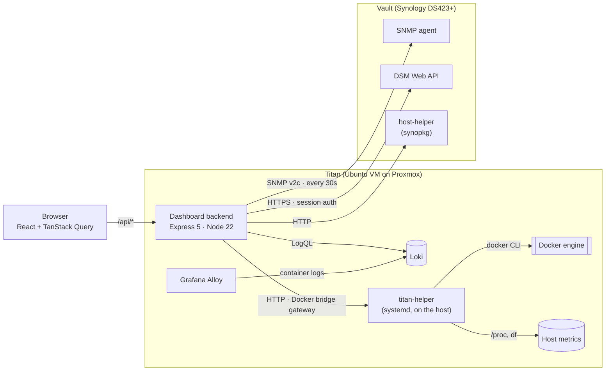

# Homelab Dashboard

<p>
  
  
  
  
  
  
</p>

A single-page dashboard for my homelab. It shows the containers, metrics, logs and hardware health of two very different hosts side by side:

- **Vault**, a Synology DS423+ NAS, monitored through **SNMP** and the **DSM Web API**
- **Titan**, an Ubuntu VM on a Proxmox host, monitored through a **small helper agent** I wrote and through **Loki**

Each host is reached a different way, and the backend combines them all into one consistent API. The React frontend shows the result as one dashboard, which works on both desktop and mobile.

<!--
  Screenshots: add docs/screenshots/desktop.png and docs/screenshots/mobile.png, then replace this comment with:

  <p align="center">
    
    
  </p>
-->

---

## Features

- **Containers from both hosts in one list.** Each card has a host badge and a status badge. A detail view shows the image, ports, networks, restart policy and uptime, and you can **start, stop and restart** containers from it.
- **Stat cards for each host.** CPU, memory, storage and network, each with its 24-hour average and peak.
- **Monitoring charts** with a Vault / Titan switch and 1h / 6h / 24h ranges. Longer ranges are averaged down so the charts stay readable.
- **Live system status** for each host: online or offline, model, uptime, load average and containers running.
- **Active alerts** produced by the backend:
  - a host or helper that can't be reached
  - stopped containers
  - disk, memory or sustained CPU over a threshold
  - **Synology hardware health**: system and power status, fans, temperatures, each drive's status and health, degraded or crashed RAID
- **Logs** for each host: Vault's DSM system log, and Titan's container logs from Loki. Identical lines in a row are merged into one row with a count.
- **Synology packages,** with their version, status, install path and size.
- **Responsive layout:** the sidebar moves below the main area, grids reduce their columns, and log rows wrap on small screens.
- **Dark mode:** follows the OS setting until you pick a theme with the header toggle, then remembers your choice. The theme is applied before the page first draws, so it doesn't flash light on refresh. The charts switch color palettes too.

---

## Architecture



| Data | Vault | Titan |
|---|---|---|
| CPU, memory, disk, network | SNMP (UCD-SNMP and HOST-RESOURCES MIBs) | titan-helper `/system` (`/proc/stat`, `/proc/meminfo`, `df`, `/proc/net/dev`) |
| Uptime, load average | SNMP (`hrSystemUptime`, `laLoad`) | titan-helper (`/proc/uptime`, `/proc/loadavg`) |
| Hardware health | SNMP, Synology MIB (`1.3.6.1.4.1.6574`) | n/a (it's a VM) |
| Containers, and starting / stopping them | DSM API (`SYNO.Docker.Container`) | titan-helper (`docker ps`, `inspect`, `start`, `stop`, `restart`) |
| Logs | DSM API (`SYNO.Core.SyslogClient`) | Loki (`{host="titan"}`) |
| Packages | host-helper (`synopkg`, `/var/packages`) | n/a |

---

## Design decisions

**A helper agent instead of mounting the Docker socket.**
The simplest way to manage Titan's containers would be to mount `/var/run/docker.sock` into the dashboard container. But that gives a web-facing container root-level control of the host. Instead, a small Express agent runs on the host under systemd. It offers only a fixed set of endpoints, checks container names against an allow-list pattern, and listens only on the Docker bridge gateway address. Containers on that network can reach it, but the rest of the LAN can't. The same pattern already existed for the NAS (`host-helper.ts` wrapping `synopkg`), so both hosts work the same way.

**One poll, kept in memory, with averaging for charts.**
The backend polls every source once every 30 seconds and keeps a 24-hour buffer for each metric (2,880 readings). Requests are answered from memory, so the charts never wait on SNMP. Ranges are selected by timestamp, and long ranges are averaged down to at most 288 points. Current, average and peak values are still calculated from every reading.

**Alerts come from data the backend already has.**
Status and alerts are worked out from the poll results already in memory, plus one container listing per request. The rules are pure functions in [`alerts.ts`](backend/src/lib/alerts.ts). Thresholds and the meaning of each Synology status code are plain constants there, so each rule is easy to read, change and test.

**Networking through the Docker bridge gateway.**
The dashboard runs in a container on a user-defined Docker network, and the helper runs on the host itself. From inside a container, `localhost` means the container, so the backend reaches the host through the network's gateway address. That address also works from the host, so dev (a code-server container) and production use the same setting.

**Repeated log lines collapsed, after finding their cause.**
Vault's log was filling with bursts of up to 30 SSH logins a minute, all coming from Titan. Tailscale routing, a reverse-proxy stream and the dev container were all ruled out. Matching Vault's log against Loki's to the second showed the cause: an SSH web client (Termix) on Titan, where each page load or session produced 10–30 log entries on the NAS. The logins were harmless, so the dashboard now merges repeated lines into one row with a count, and the rest of the log stays readable.

---

## Tech stack

| Layer | Technology |
|---|---|
| Frontend | React 19, TypeScript, Vite, Tailwind CSS 4, TanStack Query, Recharts, React Router, lucide-react |
| Backend | Node.js 22, Express 5, TypeScript, net-snmp, undici, tsx |
| Shared | One `shared/types.ts`, imported by both frontend and backend, defines the API's data shapes |
| Infrastructure | Docker, systemd, Synology DSM, SNMP v2c, Grafana Alloy and Loki, Proxmox |

---

## Project structure

```
dashboard/
├── backend/
│   └── src/
│       ├── server.ts              # Express app and route mounting
│       ├── config/appLinks.ts     # which containers have a web app, and its subdomain
│       ├── routes/
│       │   ├── services.ts        # containers on both hosts, plus start/stop/restart
│       │   ├── metrics.ts         # 30s poller, 24h buffers, ranges and averaging
│       │   ├── status.ts          # per-host status and alerts endpoint
│       │   ├── logs.ts            # DSM syslog (Vault) and Loki (Titan)
│       │   └── packages.ts        # Synology packages via the NAS helper
│       └── lib/
│           ├── alerts.ts          # alert rules and thresholds (pure, unit-tested)
│           ├── metricMath.ts      # range selection, averaging, summaries (pure, unit-tested)
│           ├── parsers.ts         # Docker, syslog and timestamp parsers (pure, unit-tested)
│           ├── synology.ts        # DSM Web API client with session refresh
│           ├── snmp.ts            # SNMP get/walk and OID definitions
│           ├── titan.ts           # client for the Titan helper
│           ├── loki.ts            # Loki query_range client
│           ├── titan-helper.ts    # agent that runs on Titan (systemd)
│           └── host-helper.ts     # agent that runs on the NAS (synopkg)
├── frontend/
│   └── src/
│       ├── pages/Dashboard.tsx
│       ├── components/            # cards, tabs, charts, modals, badges
│       ├── hooks/                 # TanStack Query hooks for each endpoint
│       ├── utils/                 # formatting, log collapsing, saved ranges, theme (unit-tested)
│       └── config/quickLinks.ts
└── shared/
    └── types.ts                   # API data shapes shared by both sides
```

---

## API

| Endpoint | Description |
|---|---|
| `GET /api/services` | Containers on both hosts. IDs are `<host>:<name>`. |
| `GET /api/services/:id` | Container detail |
| `POST /api/services/:id/{start,stop,restart}` | Container actions |
| `GET /api/metrics?type=cpu\|memory\|disk\|network&host=synology\|titan&range=1-24` | Current, average, peak and history |
| `GET /api/status` | Per-host status, alerts, and an overall `ok` / `warning` / `critical` |
| `GET /api/logs?host=synology\|titan&limit=50` | Recent log lines |
| `GET /api/packages`, `GET /api/packages/:id` | Synology packages |

---

## Running it

The dashboard needs real hosts to talk to: a Synology NAS with SNMP turned on, and a Linux host running the helper agent. A demo mode with sample data is on the roadmap.

**Backend:** create `backend/backend.env`:

```env
PORT=4000
SYNO_HOST=https://<nas-ip>:<dsm-port>
SYNO_USER=<dsm-user>
SYNO_PASS=<dsm-password>
SNMP_HOST=<nas-ip>
SNMP_COMMUNITY=<community>
SYNO_HELPER_URL=http://<nas-ip>:4111
TITAN_HELPER_URL=http://<docker-gateway-ip>:4222
LOKI_URL=http://loki:3100
```

```bash
cd backend && npm install && npm run dev
```

**Frontend:**

```bash
cd frontend && npm install && npm run dev
```

**Titan helper:** runs on the Docker host. It needs Node 22 and access to the Docker CLI.

```bash
# .env next to titan-helper.ts
TITAN_HELPER_PORT=4222
TITAN_HELPER_HOST=<docker-gateway-ip>   # listen only on the Docker bridge
TITAN_NET_IFACE=<host-nic>              # e.g. ens18

npm install express dotenv tsx
npx tsx titan-helper.ts                 # or run it as a systemd service
```

---

## Testing

The parts most likely to hide bugs are kept as pure functions and unit-tested with **Vitest**: the alert rules and every threshold boundary, the metric range selection and averaging, the Docker, syslog and SNMP parsers, and the frontend's log collapsing, formatting and theme selection.

```bash
cd backend  && npm test     # 48 tests
cd frontend && npm test     # 19 tests
```

---

## Roadmap

- [ ] Demo mode with sample data, and a hosted live demo
- [x] Unit tests for alert rules, metric averaging and parsers
- [ ] API and component tests, plus GitHub Actions CI
- [ ] Dockerfile and Compose for the dashboard, and the systemd unit for the helper
- [ ] Token authentication for the helper agents
- [ ] Metric history that survives restarts (Prometheus), for 7-day charts
- [x] Dark mode

---

## Contact

Stephen Sterling · [stephen@sterling-dev.com](mailto:stephen@sterling-dev.com)
