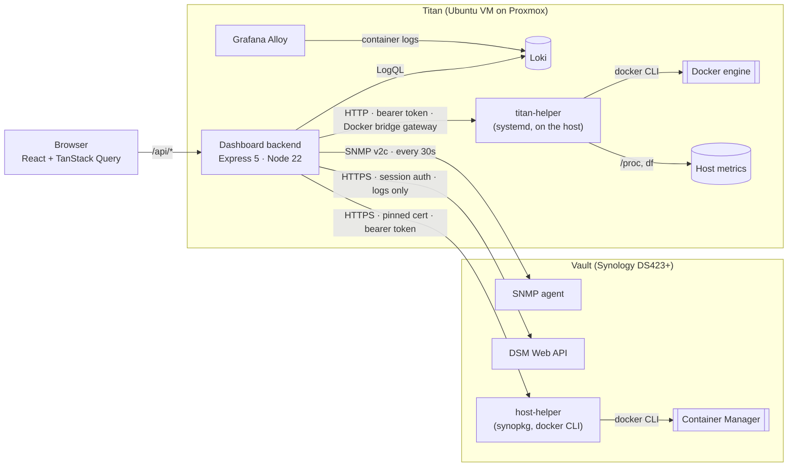

# Homelab Dashboard

<p>
  
  
  
  
  
  
</p>

A single-page dashboard for my homelab. It shows the containers, metrics, logs and hardware health of two very different hosts side by side:

- **Vault**, a Synology DS423+ NAS, monitored through **SNMP** and the **DSM Web API**
- **Titan**, an Ubuntu VM on a Proxmox host, monitored through a **small helper agent** I wrote and through **Loki**

Each host is reached a different way, and the backend combines them all into one consistent API. The React frontend shows the result as one dashboard, which works on both desktop and mobile.

<!-- Screenshots: see docs/screenshots/ (added separately) -->

---

## Features

- **Containers from both hosts in one list.** Each card has a host badge and a status badge. A detail view shows the image, ports, networks, restart policy and uptime, and you can **start, stop and restart** containers from it. Its Inspect view shows a safe subset of `docker inspect`: environment variable names but never their values, and no command line, labels or healthcheck output.
- **Stat cards for each host.** CPU, memory, storage and network, each with its 24-hour average and peak.
- **Monitoring charts** with a Vault / Titan switch and 1h / 6h / 24h ranges. Longer ranges are thinned out so the charts stay readable, keeping the highest reading from each slice so short spikes still show. A dashed line marks the peak.
- **Live system status** for each host: online or offline, model, uptime, load average and containers running.
- **Active alerts** produced by the backend:
  - a host or helper that can't be reached
  - stopped containers
  - disk, memory or sustained CPU over a threshold
  - **Synology hardware health**: system and power status, fans, temperatures, each drive's status and health, degraded or crashed RAID
- **Logs** for each host: Vault's DSM system log, and Titan's container logs from Loki. Identical lines in a row are merged into one row with a count.
- **Synology packages,** with their version, status, install path and size.
- **Responsive layout:** the sidebar moves below the main area, grids reduce their columns, and log rows wrap on small screens.
- **Dark mode:** follows the OS setting until you pick a theme with the header toggle, then remembers your choice. The theme is applied before the page first draws, so it doesn't flash light on refresh. The charts switch color palettes too.

---

## Architecture



| Data | Vault | Titan |
|---|---|---|
| CPU, memory, disk, network | SNMP (UCD-SNMP and HOST-RESOURCES MIBs) | titan-helper `/system` (`/proc/stat`, `/proc/meminfo`, `df`, `/proc/net/dev`) |
| Uptime, load average | SNMP (`hrSystemUptime`, `laLoad`) | titan-helper (`/proc/uptime`, `/proc/loadavg`) |
| Hardware health | SNMP, Synology MIB (`1.3.6.1.4.1.6574`) | n/a (it's a VM) |
| Containers, and starting / stopping them | host-helper (`docker ps`, `inspect`, `start`, `stop`, `restart`) | titan-helper (the same endpoints) |
| Logs | DSM API (`SYNO.Core.SyslogClient`) | Loki (`{host="titan"}`) |
| Packages | host-helper (`synopkg`, `/var/packages`) | n/a |

---

## Design decisions

**A helper agent instead of mounting the Docker socket.**
The simplest way to manage Titan's containers would be to mount `/var/run/docker.sock` into the dashboard container. But that gives a web-facing container root-level control of the host. Instead, a small Express agent runs on the host under systemd. It offers only a fixed set of endpoints, checks container names against an allow-list pattern, requires a bearer token on every request (a read-only token can be issued for dev), and listens only on the Docker bridge gateway address. That keeps it off the LAN. Docker doesn't generally block containers from reaching a host address, even from other networks, so the token, not the network, decides who may use it. The same pattern already existed for the NAS (`host-helper.ts` wrapping `synopkg`), so both hosts work the same way.

**Inspect output is allow-listed, not filtered.**
Raw `docker inspect` carries every secret a container was given: environment values, command-line flags, labels (for example proxy basic-auth hashes) and healthcheck commands. Rather than trying to remove those, [`inspect.ts`](backend/src/lib/inspect.ts) builds a new object from a fixed list of safe fields, so a field Docker adds later can't leak by default. The Titan helper applies its own allow-list too, because even its read-only token can call inspect.

**The NAS is trusted by certificate fingerprint, and credentials never go in a URL.**
DSM serves a certificate that normal TLS checks can't accept: its issuer (Cloudflare's Origin CA) isn't publicly trusted, and the backend connects by IP. Rather than switching verification off, which would hand the DSM password to anything on the LAN that answers as the NAS, [`certPin.ts`](backend/src/lib/certPin.ts) accepts exactly one certificate, by its SHA-256 fingerprint (`SYNO_CERT_SHA256`), and checks it before any request is sent. TLS session resumption is turned off, so every connection does a full handshake and proves the certificate again (a resumed session reports no certificate, which would make reconnects fail the pin). Without a valid fingerprint the backend refuses to contact DSM at all. The NAS helper is reached the same way: its token crosses the LAN (unlike the Titan helper's, which never leaves the host), so it serves only HTTPS (TLS 1.3) with its own self-signed certificate, pinned by `SYNO_HELPER_CERT_SHA256`. Every DSM call is a POST with the password or session ID in the body, so they never land in access logs. The DSM account is a dedicated, locked-down admin, not a personal one. It's now used only for Vault's logs; containers moved to the NAS helper, so the read-only dev token can't start or stop them, and the account goes away once the logs move to Loki.

**One poll, kept in memory and saved to a file, thinned out for charts.**
The backend polls every source once every 30 seconds and keeps a 24-hour buffer for each metric (2,880 readings). The buffers are saved to one JSON file every 5 minutes and on shutdown, and read back on start, so a redeploy or reboot leaves only a gap in the charts ([`historyStore.ts`](backend/src/lib/historyStore.ts); about 1–2 MB). A Prometheus server would add longer retention and PromQL, but for 24 hours of a dozen series it would be one more service to run for no visible gain. Requests are answered from memory, so the charts never wait on SNMP. Ranges are selected by timestamp, and long ranges are reduced to at most 288 points by keeping the highest reading from each group, so a 30-second spike isn't averaged away. Current, average and peak values are still calculated from every reading.

**Alerts come from data the backend already has.**
Status and alerts are worked out from the poll results already in memory, plus one container listing per request. The rules are pure functions in [`alerts.ts`](backend/src/lib/alerts.ts). Thresholds and the meaning of each Synology status code are plain constants there, so each rule is easy to read, change and test.

**Networking through the Docker bridge gateway.**
The dashboard runs in a container on a user-defined Docker network, and the helper runs on the host itself. From inside a container, `localhost` means the container, so the backend reaches the host through the network's gateway address. That address also works from the host, so dev (a code-server container) and production use the same setting.

**Repeated log lines collapsed, after finding their cause.**
Vault's log was filling with bursts of up to 30 SSH logins a minute, all coming from Titan. Tailscale routing, a reverse-proxy stream and the dev container were all ruled out. Matching Vault's log against Loki's to the second showed the cause: an SSH web client (Termix) on Titan, where each page load or session produced 10–30 log entries on the NAS. The logins were harmless, so the dashboard now merges repeated lines into one row with a count, and the rest of the log stays readable.

---

## Tech stack

| Layer | Technology |
|---|---|
| Frontend | React 19, TypeScript, Vite, Tailwind CSS 4, TanStack Query, Recharts, React Router, lucide-react |
| Backend | Node.js 22, Express 5, TypeScript, net-snmp, undici, tsx |
| Shared | One `shared/types.ts`, imported by both frontend and backend, defines the API's data shapes |
| Infrastructure | Docker, systemd, Synology DSM, SNMP v2c, Grafana Alloy and Loki, Proxmox |

---

## Project structure

```
dashboard/
├── backend/
│   └── src/
│       ├── server.ts              # Express app and route mounting
│       ├── config/appLinks.ts     # which containers have a web app, and its subdomain
│       ├── routes/
│       │   ├── services.ts        # containers on both hosts, plus start/stop/restart
│       │   ├── metrics.ts         # 30s poller, 24h buffers, ranges and downsampling
│       │   ├── status.ts          # per-host status and alerts endpoint
│       │   ├── logs.ts            # DSM syslog (Vault) and Loki (Titan)
│       │   └── packages.ts        # Synology packages via the NAS helper
│       └── lib/
│           ├── alerts.ts          # alert rules and thresholds (pure, unit-tested)
│           ├── metricMath.ts      # range selection, downsampling, summaries (pure, unit-tested)
│           ├── inspect.ts         # allow-listed docker inspect for the Inspect view (pure, unit-tested)
│           ├── parsers.ts         # Docker, syslog and timestamp parsers (pure, unit-tested)
│           ├── synology.ts        # DSM Web API client with session refresh (Vault logs)
│           ├── certPin.ts         # trust one certificate by SHA-256 fingerprint (DSM and the NAS helper)
│           ├── nasHelper.ts       # client for the NAS helper (pinned HTTPS, bearer token)
│           ├── snmp.ts            # SNMP get/walk and OID definitions
│           ├── titan.ts           # client for the Titan helper
│           ├── loki.ts            # Loki query_range client
│           ├── titan-helper.ts    # agent that runs on Titan (systemd)
│           └── host-helper.ts     # agent that runs on the NAS (synopkg, docker CLI)
├── frontend/
│   └── src/
│       ├── pages/Dashboard.tsx
│       ├── components/            # cards, tabs, charts, modals, badges
│       ├── hooks/                 # TanStack Query hooks for each endpoint
│           ├── historyStore.ts    # saves and restores metric history (HISTORY_FILE)
│           ├── containers.ts      # maps both helpers' docker output to services
│       ├── utils/                 # formatting, log collapsing, saved ranges, theme (unit-tested)
│       └── config/                # sidebar quick links, API base URL
├── shared/
│   └── types.ts                   # API data shapes shared by both sides
├── scripts/dev.sh                 # dev mode: backend and Vite together
├── package.json                   # npm run dev / test
├── Dockerfile                     # builds both, runs the backend serving the frontend
└── docker-compose.yml             # production compose: builds a pinned commit from GitHub
```

---

## API

| Endpoint | Description |
|---|---|
| `GET /api/services` | Containers on both hosts. IDs are `<host>:<name>`. |
| `GET /api/services/:id` | Container detail |
| `GET /api/services/:id/inspect` | Allow-listed `docker inspect` (env names only, no values) |
| `POST /api/services/:id/{start,stop,restart}` | Container actions |
| `GET /api/metrics?type=cpu\|memory\|disk\|network&host=synology\|titan&range=1-24` | Current, average, peak and history |
| `GET /api/status` | Per-host status, alerts, and an overall `ok` / `warning` / `critical` |
| `GET /api/logs?host=synology\|titan&limit=50` | Recent log lines |
| `GET /api/packages`, `GET /api/packages/:id` | Synology packages |
| `GET /api/health` | Liveness check (used by the container healthcheck) |

---

## Running it

The dashboard needs real hosts to talk to: a Synology NAS with SNMP turned on, and a Linux host running the helper agent. A demo mode with sample data is on the roadmap.

**Backend:** create `backend/backend.env` for dev. In production the same file sits beside `docker-compose.yml` on the server, with the helper's full token instead of the read-only one:

```env
PORT=4000
SYNO_HOST=https://<nas-ip>:<dsm-port>
SYNO_USER=<dsm-user>
SYNO_PASS=<dsm-password>
SYNO_CERT_SHA256=<sha256 fingerprint of the DSM certificate>   # openssl s_client -connect <nas-ip>:<dsm-port> </dev/null | openssl x509 -noout -fingerprint -sha256
SNMP_HOST=<nas-ip>
SNMP_COMMUNITY=<community>
SYNO_HELPER_URL=https://<nas-ip>:4111
SYNO_HELPER_CERT_SHA256=<sha256 fingerprint of the helper's certificate>
SYNO_HELPER_TOKEN=<token>       # the NAS helper's full token in production, its read-only token in dev
TITAN_HELPER_URL=http://<docker-gateway-ip>:4222
TITAN_HELPER_TOKEN=<token>      # the helper's full token in production, its read-only token in dev
LOKI_URL=http://loki:3100
PROXY_SECRET=<openssl rand -hex 32>   # production only; the same value goes in NPM (see Login below)
```

There are two ways to run it, and they don't interfere with each other. Each has its own backend and its own history. The container saves its history to a Docker volume; dev keeps it in memory unless `HISTORY_FILE` is set in `backend.env`.

| | Container | Dev |
|---|---|---|
| Command | `docker compose up -d --build` (on Titan, from `/opt`) | `npm run dev` (repo root) |
| What runs | one container: the backend also serves the built frontend | `tsx watch` backend on :4000 and the Vite dev server on :5173 |
| Picks up changes | when you release a commit and rebuild | on save |
| Used for | the dashboard you actually use | trying changes before deploying them |

**Container** (on Titan, where Docker runs). The deploy never reads the workspace: [`docker-compose.yml`](docker-compose.yml) builds a release straight from GitHub, pinned by its full commit hash rather than its tag. Tags can be moved or recreated by anyone who can push to the repo; a commit hash can't, so a later push can't change what a rebuild produces.

```bash
# in the repo: release a version
git tag v1.0.3 && git push origin main v1.0.3
git rev-parse v1.0.3          # the full hash goes in the compose file's build context

# on Titan
cd /opt/docker/compose/homelab-dashboard   # docker-compose.yml (copied from the repo) + backend.env
chmod 600 backend.env
docker compose up -d --build
```

To deploy a new version: tag and push it, put its full commit hash in the compose file's `context` (`…dashboard.git#<hash>`) and its tag in `image`, commit and push that, copy the file over and rebuild. Old images stay tagged, so rolling back is putting the previous hash and tag back.

The compose file reads `backend.env` from its own folder, passes the Grafana URL as a build argument, sets the time zone, runs the container read-only with no Linux capabilities, keeps metric history in the `history` volume (the only writable place besides `/tmp`), and joins the existing `private_titan` Docker network so the dashboard can reach Loki and the Titan helper. It publishes no ports, so the dashboard is reached only through Nginx Proxy Manager, which also provides the login.

**Login (Nginx Proxy Manager).** NPM asks for a password, and the backend makes sure that can't be skipped or abused (see [`requestGuards.ts`](backend/src/lib/requestGuards.ts)):

1. **Access list:** *Satisfy All* (both rules must pass), an *Authorization* user with a long generated password, *Access* allowing your LAN subnet and denying everything else, and *Pass Auth to Host* off, so the password never reaches the app.
2. **Proxy host** for the dashboard's domain: apply the access list, force SSL and turn on HSTS. Under *Custom locations*, add location `/` forwarding to `http` `homelab-dashboard` port `4000`, and in its advanced settings:
   ```nginx
   proxy_set_header X-Proxy-Secret <same value as PROXY_SECRET>;
   proxy_set_header X-Remote-User $remote_user;
   ```
   (A custom location is needed because nginx drops server-level `proxy_set_header` lines when the location sets its own, which NPM's default location does.)
3. **Check:** without the password, `curl https://<domain>/api/status` gets 401 (or 403 from outside the LAN). With it, it gets data.

Without `X-Proxy-Secret` the backend answers 403, so anything that reaches the container directly on the Docker network gets nothing. In production it won't start without `PROXY_SECRET`. Actions (start, stop, restart) also need a header that only the dashboard's own page sends, and the API offers no CORS, so a malicious page can't use the browser's saved login to trigger them. Each action is logged with the NPM username.

**Dev:**

```bash
npm --prefix backend install
npm --prefix frontend install
npm run dev             # Ctrl+C stops both
```

Open `http://localhost:5173`. Vite forwards `/api` to the dev backend. Behind a path-based proxy such as code-server's, give the frontend a `frontend/.env`:

```env
VITE_BASE_PATH=/proxy/5173
VITE_API_URL=/proxy/4000
```

**Titan helper:** runs on the Docker host. It needs Node 22 and access to the Docker CLI.

```bash
# .env next to titan-helper.ts
TITAN_HELPER_PORT=4222
TITAN_HELPER_HOST=<docker-gateway-ip>   # listen only on the Docker bridge
TITAN_NET_IFACE=<host-nic>              # e.g. ens18
TITAN_HELPER_TOKEN=<openssl rand -hex 32>        # required; full access, for the production dashboard
TITAN_HELPER_READ_TOKEN=<openssl rand -hex 32>   # optional; GET only, for dev (can't start/stop)

npm install express dotenv tsx
npx tsx titan-helper.ts                 # or run it as a systemd service
```

**NAS helper:** runs on the NAS as root (`synopkg` and Container Manager's `docker` need it), started by a boot-time Task Scheduler task. Keep its folder and `.env` outside every shared folder and readable only by root: anyone who could edit a script that root runs would have root on the NAS. It refuses to start without an explicit LAN address, a certificate and key, and a token.

```bash
# Self-signed certificate (the dashboard pins its fingerprint, so no CA is involved)
openssl req -x509 -newkey ec -pkeyopt ec_paramgen_curve:prime256v1 -nodes -days 3650 \
  -subj "/CN=vault-helper" -keyout helper-key.pem -out helper-cert.pem
chmod 600 helper-key.pem
openssl x509 -in helper-cert.pem -noout -fingerprint -sha256   # → SYNO_HELPER_CERT_SHA256

# .env next to host-helper.ts
SYNO_HELPER_PORT=4111
SYNO_HELPER_HOST=<nas-ip>               # the LAN address only; 0.0.0.0 is refused
SYNO_HELPER_TLS_CERT=<path>/helper-cert.pem
SYNO_HELPER_TLS_KEY=<path>/helper-key.pem
SYNO_HELPER_TOKEN=<openssl rand -hex 32>        # required; full access, for the production dashboard
SYNO_HELPER_READ_TOKEN=<openssl rand -hex 32>   # optional; GET only, for dev
```

---

## Testing

The parts most likely to hide bugs are kept as pure functions and unit-tested with **Vitest**: the alert rules and every threshold boundary, the metric range selection and downsampling, inspect sanitizing (with planted secrets), the Docker, syslog and SNMP parsers, and the frontend's log collapsing, formatting and theme selection.

```bash
cd backend  && npm test     # 102 tests
cd frontend && npm test     # 20 tests
npm test                    # both, from the repo root
```

---
DOCKER_PATH=/usr/local/bin/docker               # optional; Container Manager's docker CLI (the default)

## Roadmap

- [ ] Demo mode with sample data, and a hosted live demo
- [x] Unit tests for alert rules, metric downsampling, inspect sanitizing and parsers
- [ ] API and component tests, plus GitHub Actions CI
- [x] Dockerfile and Compose for the dashboard
- [ ] systemd unit for the Titan helper in the repo
- [x] Token authentication for the Titan helper, with a read-only token for dev
- [x] Token authentication and pinned HTTPS for the NAS helper
- [x] A login in front of the dashboard (NPM basic auth, with a proxy secret and CSRF protection so it can't be bypassed)
- [x] Metric history that survives restarts (saved to a file on a volume)
- [ ] 7-day charts
- [x] Dark mode

---

## Contact

Stephen Sterling · [stephen@sterling-dev.com](mailto:stephen@sterling-dev.com)
